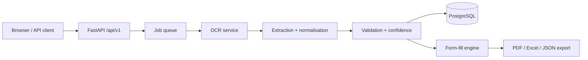

# Enterprise OCR Platform — Document Extraction & Form Auto-Fill

[](https://github.com/NISHANTH-S-06/enterprise-ocr-platform/actions/workflows/ci.yml)

An async FastAPI service that turns scanned invoices, purchase orders and similar business documents into **validated, structured data** and fills company-specific forms from it. Every extracted field carries a confidence label and a source trace, so a reviewer can see *where* a value came from and correct it.

> Built during my AI Developer & Designer internship. Only synthetic or anonymised demo data is used in this repository; private datasets are not included.

## What it does
`upload → OCR → extract fields → normalise → validate → review/correct → auto-fill form → export (PDF / Excel / JSON)`

- **OCR pipeline** (PaddleOCR, PDF pages via PyMuPDF) with per-field confidence labels
- **Company detection and form mapping**: detects the issuing company and maps fields to that company's form template
- **Validation and normalisation**: dates, amounts, invoice numbers, synonyms; flags missing or suspicious fields
- **Correction memory**: reviewer corrections are stored and re-applied to later documents
- **Duplicate detection**, **export pre-checks** and **audit logs**
- **Field evidence / source tracing** and a **benchmark framework** (see `README_TRACE.md`, `README_BENCHMARK.md`)
- JWT auth, multi-tenant organisations with usage limits

## Architecture


## Tech stack
FastAPI · SQLAlchemy (async, asyncpg) · PostgreSQL · Alembic · PaddleOCR · PyMuPDF · ReportLab · OpenPyXL · JWT · Docker · pytest

## Quick start
```bash
cp .env.example .env          # set SECRET_KEY and DATABASE_URL (PostgreSQL)
pip install -r requirements.txt
alembic upgrade head
uvicorn app.main:app --reload --port 8000
```
Open http://127.0.0.1:8000/docs. With Docker: `docker-compose up -d`.

## Tests
```bash
pytest -q        # 616 passed, 4 skipped (the 4 need private sample documents: set OCR_DATASET_DIR)
```
CI runs the suite on every push (PaddleOCR is not installed in CI; tests use fixtures).

## Production and release docs
`docs/PRODUCTION_DEPLOYMENT_RUNBOOK.md` · `docs/PRODUCTION_CHECKLIST.md` · `docs/RELEASE_NOTES_RC1.md` · `docs/API_ENDPOINT_SUMMARY.md`

## API Flow

1. `POST /api/v1/auth/login` → JWT token
2. `POST /api/v1/fill/` with `extracted_data_id` + `export_format` (pdf/excel/json)
3. `GET  /api/v1/fill/jobs/{id}/download` → file

## Run Tests

```powershell
pytest tests/ -v
```

## Windows local run (PaddleOCR + static frontend)

Backend:

```powershell
cd enterprise-ocr-platform
$env:FLAGS_use_mkldnn="0"
$env:FLAGS_enable_pir_api="0"
$env:OMP_NUM_THREADS="1"
$env:PADDLE_CPP_LOGLEVEL="3"
.\.venv311\Scripts\python.exe -m uvicorn app.main:app --reload --host 127.0.0.1 --port 8000
```

Frontend:

```powershell
cd frontend
python -m http.server 3000 --bind 127.0.0.1
```

Open:

```text
http://127.0.0.1:3000
```

Upload API smoke test:

```powershell
$token = "<JWT_TOKEN>"
curl.exe -X POST "http://127.0.0.1:8000/api/v1/upload/" -H "Authorization: Bearer $token" -F "file=@<INVOICE_IMAGE_PATH>"
curl.exe -H "Authorization: Bearer $token" "http://127.0.0.1:8000/api/v1/upload/jobs/<JOB_ID>"
```

Scripted upload checks:

```powershell
cd enterprise-ocr-platform
.\scripts\test_upload_flow.ps1 -Token $token -ImagePath "<INVOICE_IMAGE_PATH>" -PdfPath "<INVOICE_PDF_PATH>" -LargeImagePath "<LARGE_IMAGE_PATH>"
```

Expected OCR JSON shape from both upload and job polling responses:

```json
{
  "success": true,
  "text": "",
  "raw_text_length": 0,
  "detected_line_count": 0,
  "raw_text_preview": "",
  "fields": {},
  "confidence": {},
  "warnings": []
}
```

## DB Tables
organisations · users · user_sessions · api_keys · uploaded_files · file_pages ·
ocr_jobs · job_events · extracted_data · extraction_templates · audit_logs · system_logs · form_fill_jobs
