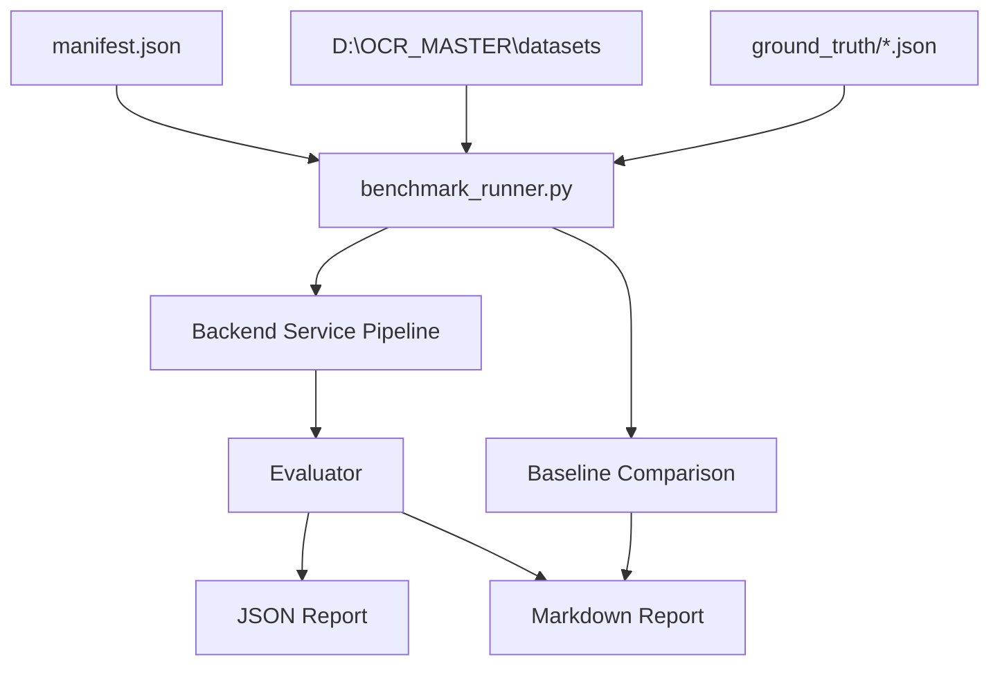

# OCR Accuracy Benchmark Foundation (Phase 1)

This framework provides deterministic metrics to evaluate document classification, company matching, header extraction, dates/amounts validation, item-row structures, false positives, and speed across our standard document sets.

---

## Architecture Diagram



---

## Directory Structure

All benchmark resources are located in the `tests/benchmark/` directory:
- [manifest.json](file:///d:/OCR_MASTER/ocr-platform-complete/tests/benchmark/manifest.json): Configuration file listing all test documents and pointing to their respective ground-truth annotations.
- `ground_truth/`: Folder containing ground-truth JSON files for each PDF:
  - [salesinvoice_gt.json](file:///d:/OCR_MASTER/ocr-platform-complete/tests/benchmark/ground_truth/salesinvoice_gt.json)
  - [Glsprint_gt.json](file:///d:/OCR_MASTER/ocr-platform-complete/tests/benchmark/ground_truth/Glsprint_gt.json)
  - [POPRINT_gt.json](file:///d:/OCR_MASTER/ocr-platform-complete/tests/benchmark/ground_truth/POPRINT_gt.json)
  - [GRN_gt.json](file:///d:/OCR_MASTER/ocr-platform-complete/tests/benchmark/ground_truth/GRN_gt.json)
- [benchmark_runner.py](file:///d:/OCR_MASTER/ocr-platform-complete/tests/benchmark/benchmark_runner.py): CLI utility to run the benchmark and generate reports.

---

## CLI Usage

### 1. Run Benchmark
Runs the pipeline on all documents defined in the manifest and writes candidate reports:
```powershell
$env:PYTHONPATH="d:\OCR_MASTER\ocr-platform-complete"
.venv311\Scripts\python tests/benchmark/benchmark_runner.py `
  --output-json benchmark_report_candidate.json `
  --output-md benchmark_report_candidate.md
```

### 2. Compare Candidate with Baseline
To measure improvements or regressions, first save a copy of the candidate report as your baseline:
```powershell
cp benchmark_report_candidate.json benchmark_report_baseline.json
```
Then run the benchmark runner with the `--compare-with` flag pointing to the baseline JSON file:
```powershell
$env:PYTHONPATH="d:\OCR_MASTER\ocr-platform-complete"
.venv311\Scripts\python tests/benchmark/benchmark_runner.py `
  --compare-with benchmark_report_baseline.json `
  --output-json benchmark_report_candidate.json `
  --output-md benchmark_report_candidate.md
```

---

## Computed Metrics

The benchmark measures the following metrics:
- **Document Classification**: Verifies if the classified document type matches the expected ground-truth type.
- **Company/Template Matching**: Verifies if the resolved company matches the expected company name.
- **Header Fields**: String-normalized matching of vendor, buyer, addresses, HSN, taxation, and terms.
- **Dates and Amounts**: Matches invoice/PO dates, grand totals, exchange rates, and IGST totals.
- **Item Rows**: Verifies count of extracted items and compares fields of the first row (SNo, article, qty, rate, total).
- **Missing Fields**: Confirms expected absent fields are empty in actual results.
- **False Positives**: Identifies fields that were expected to be empty but got filled with values.
- **Auto-fill Coverage**: Ratio of successfully extracted fields to expected fields.
- **Processing Time**: Duration of the pipeline execution in milliseconds.

> [!NOTE]
> All string comparison metrics normalize whitespaces, currency symbols (₹, $, €, £), punctuation, and casing to ensure comparisons are robust.

> [!WARNING]
> Do not commit generated reports (`benchmark_report_*` or `benchmark_results_*`). They are ignored by `.gitignore` rules.
